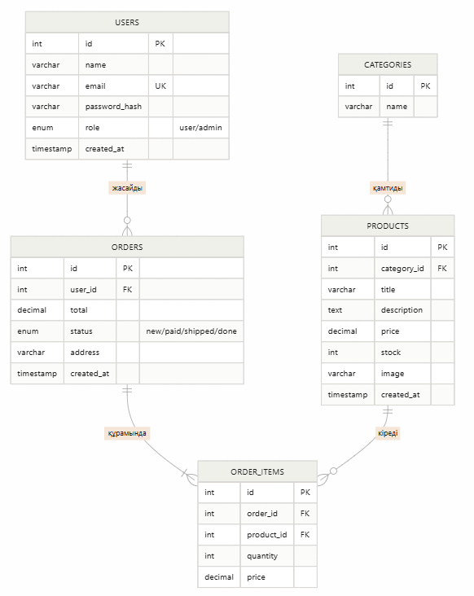

# php-minishop
minishop
# Шағын онлайн дүкен (PHP + MySQL)

Жеке жобалық тапсырма: PHP және MySQL қолданып әзірленген шағын онлайн дүкен веб-қосымшасы.

**Автор:** Болатқызы Асылай 
**Топ:** АЖ-336  
**Мерзімі:** 8 апта (8–15 апта)

## 1. Жобаның мақсаты

Пайдаланушы тауарларды каталогтан қарап, іздеп, себетке салып, тапсырыс бере алатын, ал әкімші тауарлар мен тапсырыстарды басқара алатын шағын онлайн дүкен жасау.

## 2. Технологиялар

- PHP 8 (PDO)
- MySQL / MariaDB
- HTML5, CSS3, JavaScript
- Git / GitHub
- Локалды сервер: XAMPP (немесе OpenServer)
- Хостинг: InfinityFree

## 3. Негізгі мүмкіндіктер

**Қонақ үшін:** тауарлар каталогын көру, тауар беті, іздеу және санат бойынша сүзу.

**Тіркелген пайдаланушы үшін:** тіркелу, кіру/шығу, себетке салу, тапсырыс беру, тапсырыстар тарихы, профиль.

**Әкімші (admin) үшін:** тауарларды қосу, өңдеу, жою (CRUD), санаттарды басқару, тапсырыс статусын өзгерту.

## 4. Беттер тізімі

| № | Бет | Файл | Кімге |
|---|-----|------|-------|
| 1 | Басты бет (жаңа тауарлар) | `index.php` | Барлығы |
| 2 | Тауарлар каталогы (іздеу, сүзгі, пагинация) | `products.php` | Барлығы |
| 3 | Тауар беті | `product.php` | Барлығы |
| 4 | Тіркелу | `register.php` | Қонақ |
| 5 | Кіру | `login.php` | Қонақ |
| 6 | Шығу | `logout.php` | Пайдаланушы |
| 7 | Себет | `cart.php` | Пайдаланушы |
| 8 | Тапсырыс беру | `checkout.php` | Пайдаланушы |
| 9 | Менің тапсырыстарым / профиль | `profile.php` | Пайдаланушы |
| 10 | Әкімші: тауарлар тізімі | `admin/products.php` | Admin |
| 11 | Әкімші: тауар қосу/өңдеу | `admin/product_form.php` | Admin |
| 12 | Әкімші: тапсырыстар | `admin/orders.php` | Admin |

## 5. Дерекқор құрылымы (ER-диаграмма)

Төменде MiniShop жобасының дерекқор құрылымы көрсетілген.



## 6. Жоба құрылымы

```
shop/
├── index.php
├── products.php
├── product.php
├── cart.php
├── checkout.php
├── login.php / register.php / logout.php
├── profile.php
├── admin/
├── includes/        (header.php, footer.php, db.php, auth.php)
├── assets/          (css, js, images)
├── uploads/
└── database/schema.sql
```

## 7. Жұмыс жоспары

| Апта | Тақырып | Нәтиже |
|------|---------|--------|
| 8 | Жоспарлау, репозиторий | README, беттер тізімі, ER-диаграмма |
| 9 | Frontend (HTML/CSS/JS) | Кемінде 3 статикалық бет |
| 10 | PHP негіздері | include, формалар, валидация |
| 11 | MySQL және аутентификация | Тіркелу, кіру, шығу |
| 12 | CRUD | Тауарлар CRUD |
| 13 | Іздеу, сүзгі, пагинация | Каталог |
| 14 | Қосымша функция, қауіпсіздік | Себет/тапсырыс, рөлдер, XSS/SQLi қорғау |
| 15 | Тестілеу, хостинг, қорғау | Хостингтегі жоба, презентация |
